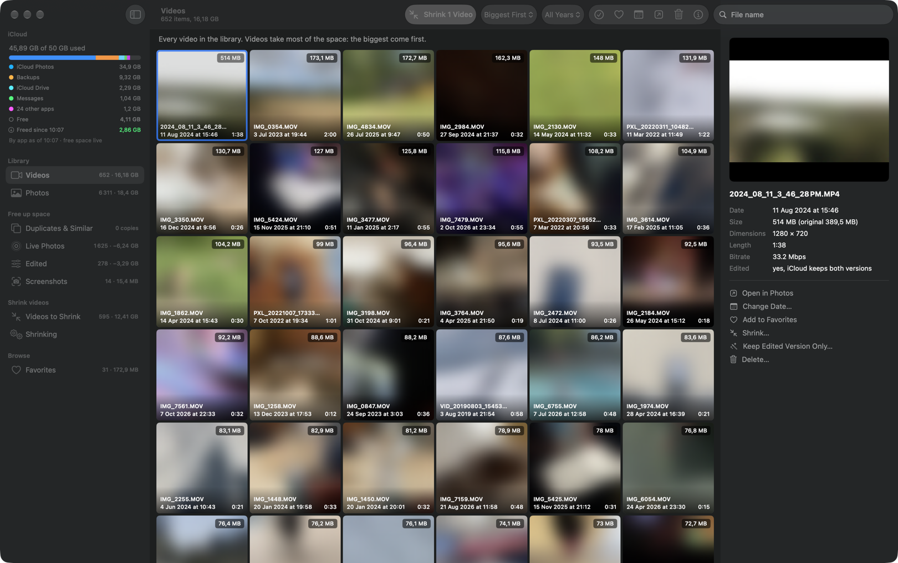
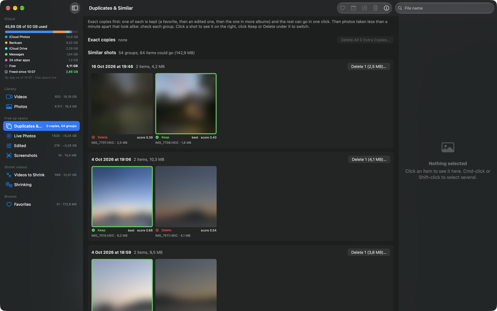
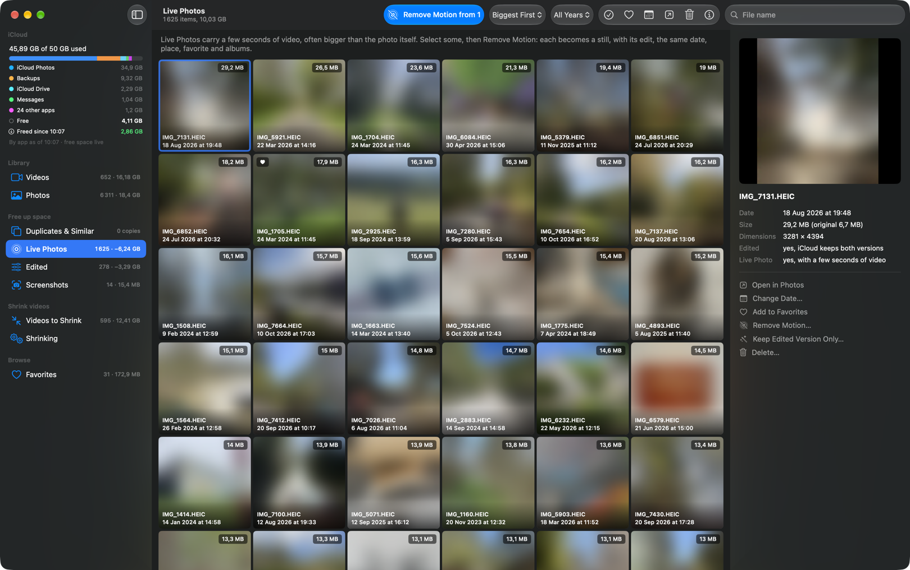

# Darkroom 📸

A Mac app to see what fills your iCloud Photos, and to clean it up. It shows what each photo and video
really costs in iCloud, finds duplicates and near-identical shots, strips the motion from Live Photos,
drops the originals kept under edits, shrinks videos, and fixes dates in batches. Native SwiftUI on
Apple's PhotoKit: the library never leaves your Mac, and every deletion goes through macOS's own
confirmation.



<sub>Photos are blurred in these screenshots, with the app's `BlurPhotos` setting.</sub>

## Why

iCloud says "Photos: 35 GB" and nothing more. Most of it is rarely the photos themselves:

- **Live Photos** carry a few seconds of video, often bigger than the photo. On the library this was built
  on, 1,600 Live Photos held 5.7 GB of motion.
- **Edits** keep the original *and* the edited version, and an edited Live Photo keeps two motion clips.
- **Videos** are usually the biggest items by far, and a few are worth re-encoding.
- **Bursts and retakes**: several shots of the same moment.

Darkroom counts every file iCloud stores for an item, so the sizes it shows add up to what iCloud bills.

## What it does

| View | What it does |
|---|---|
| Videos, Photos | everything, biggest first, with the size iCloud really stores |
| Duplicates & Similar | exact copies first, which can all go in one click; then photos taken less than a minute apart that look alike, with the best one picked to keep |
| Live Photos | **Remove Motion**: each one becomes a still, with its edit, the same date, place, favorite and albums |
| Edited | **Keep Edited Version**: the edited version alone replaces the item, and the original under it goes; a Live Photo stays live, with its edited motion |
| Only Rotated | edits that only rotate an item (or change nothing), where the original is a full extra copy: same Keep Edited Version |
| Screenshots | rarely worth keeping for long |
| Shrinking | re-encodes the videos you pick in Videos to a smaller file, keeping a copy only when it looks the same |
| Favorites | what the name says |



Select items (click, Cmd-click, Shift-click, or right-click) to delete them, add them to Favorites, change
their date or open them in Photos (double-click does that too). Deleted items stay in Recently Deleted for
30 days, where you can get them back. iCloud seems to free their space right away: on the library this was
built on, the free space rose as soon as items were deleted, while they were still in Recently Deleted.

Changing dates: move a set so the earliest gets a date and the others keep their spacing, set an exact
date, shift by an amount, or read the date from the file name (`%Y%m%d_%H%M%S` reads
`IMG_20240714_183000`).



## Install

Needs macOS 26 or later and Xcode. Open `Darkroom.xcodeproj` and press Run, or from the terminal:

```
xcodebuild -project Darkroom.xcodeproj -scheme Darkroom -destination 'platform=macOS' -derivedDataPath build build
open build/Build/Products/Debug/Darkroom.app
```

Set your own `DEVELOPMENT_TEAM` and `PRODUCT_BUNDLE_IDENTIFIER` in the target's build settings first. On
first launch macOS asks for access to Photos: choose Allow Full Access.

Shrinking videos also needs ffmpeg from Homebrew (`brew install ffmpeg`), which comes with libx265 and
libvmaf. Everything else works without it.

## How it works, and why

- **Sizes** come from each asset's resources (`PHAssetResource` and its `fileSize` key, which is not public
  API but the only way to know a size without downloading the file). Reading them costs a query per item,
  so they are cached between reloads.
- **iCloud storage by app** has no API. macOS's iCloud notification agent caches the answers of Apple's
  quota service in `~/Library/Caches/com.apple.iCloudNotificationAgent/Cache.db`, among them
  `getCloudStorageApps`: the numbers System Settings shows. The plan size follows from the share of the plan
  each app takes, and `brctl quota` gives the free space live, every minute. macOS refreshes the split by app
  only now and then, so the sidebar also shows what was freed since, and a running total of what Darkroom
  itself freed, kept across launches in `~/Library/Application Support/Darkroom/savings.json`. iCloud counts in powers of 1024
  (37,472,142,715 bytes show as "34.9 GB"), so the app does too.
- **Recently Deleted**: PhotoKit never shows deleted items to other apps, even through its private options, so
  Darkroom reads their count and size from Photos' own database, read-only. macOS allows that only with Full
  Disk Access; without it, the sidebar offers to open the setting.
- **Similar shots** compare a 64-bit difference hash of a small render: one bit per pixel of a 9x8 grey
  thumbnail, set when it is brighter than its right neighbour. On a 7,000-item library, shots of the same
  moment differed by up to about 16 bits, different scenes by 20 to 40, even 3 seconds apart. Vision's
  feature print was measured too and dropped: it calls two framings of the same view "very close", and
  those are both worth keeping. The keeper is a favorite or edited shot first, then the best Vision
  aesthetics score.
- **Only Rotated** reads the edit Photos saves with each item: a property list around compressed JSON, whose
  adjustments (crop, light, filters…) can each be switched off. A rotation is kept apart from them, so an edit
  with every adjustment off only rotates, or changes nothing.
- **Remove Motion and Keep Edited Version** ask Photos for the item as it looks now (an unedited photo comes
  back as its original file, not re-encoded), save it as a new item with the same date, place, favorite and
  albums, and delete the old one in the same change. macOS asks once per batch of 200, and a batch you refuse
  leaves nothing behind. Keep Edited Version saves an edited Live Photo's rendered still and motion
  together: Photos writes the same pairing id in both, so the new item is a Live Photo again.
- **Shrinking videos**: each video is exported from Photos as it looks now (a rotated or trimmed video keeps
  its edit; Photos stores those twice, so deleting the original frees both), re-encoded with libx265 (CRF 26, or 28 for
  "Smaller files", every frame kept at its original time), then scored with VMAF against the original
  (100 = identical). VMAF pairs frames by index: iPhone videos have an uneven frame rate, and pairing them by
  timestamp scores a perfect copy around 45. The copy goes into Photos only when it is at least 20% smaller
  and scores 93 or more (88 for "Smaller files"); the originals go when you press Delete Originals. A copy
  refused only for its score waits in `~/Library/Caches/Darkroom/Previews`: the Shrinking view plays it and
  the original in one player that switches between the two at the same moment, and saves it anyway if it
  looks fine. Apple's
  own HEVC encoder was tried and made iPhone videos bigger at the same quality. Expect savings on some videos
  only: iPhone footage is already well compressed.
- **Open in Photos** uses a `photos-navigation://asset?uuid=` link. AppleScript's `spotlight` command
  crashes Photos on macOS 27.
- The app is not sandboxed (it reads that cache and runs `brctl` and ffmpeg), with the hardened runtime and
  the `com.apple.security.personal-information.photos-library` entitlement it needs to reach Photos. So it
  cannot go on the App Store as it is.

## Limits

- PhotoKit cannot change a photo's time zone: dates are picked on this Mac's clock.
- Items that are replaced (Remove Motion, Keep Edited Version, shrunk videos) keep their date, place,
  favorite and albums, but not titles, keywords or the names of people tagged in them.
- Shared albums are left out: they do not count against your iCloud storage.

## Files

| File | Role |
|---|---|
| `Darkroom/Model/Library.swift` | loading the library, the sizes cache, and every change |
| `Darkroom/Model/Item.swift` | an item and the files behind it |
| `Darkroom/Model/Similar.swift` | similar shots |
| `Darkroom/Model/Replacer.swift` | Remove Motion and Keep Edited Version |
| `Darkroom/Model/Shrinker.swift`, `FFmpeg.swift` | shrinking videos |
| `Darkroom/Model/ICloudStorage.swift` | iCloud storage by app |
| `Darkroom/Model/Savings.swift` | the space Darkroom freed, kept across launches |
| `Darkroom/Model/DateChange.swift` | date changes and reading dates from file names |
| `Darkroom/Model/Destination.swift` | the sidebar entries and sort orders |
| `Darkroom/Views/` | the SwiftUI views |

## License

[MIT](LICENSE)
